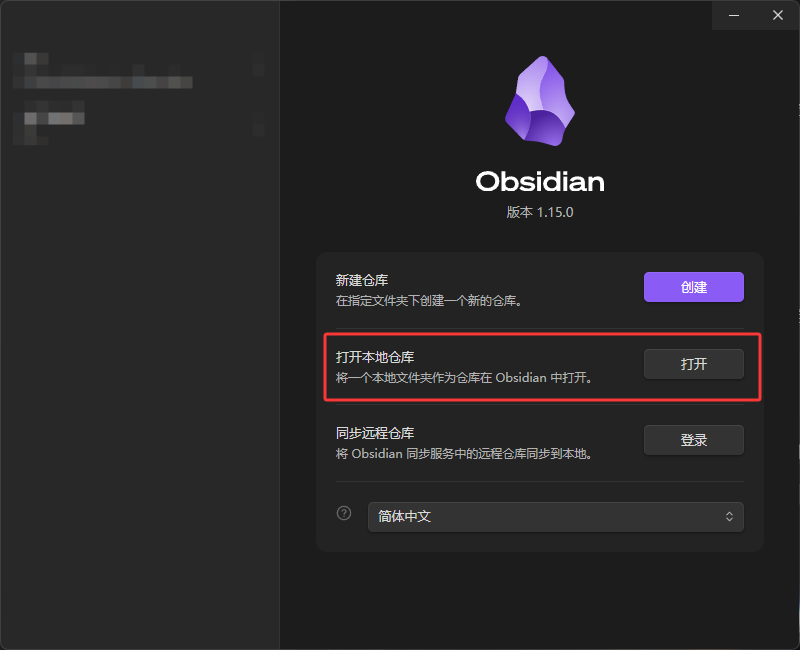
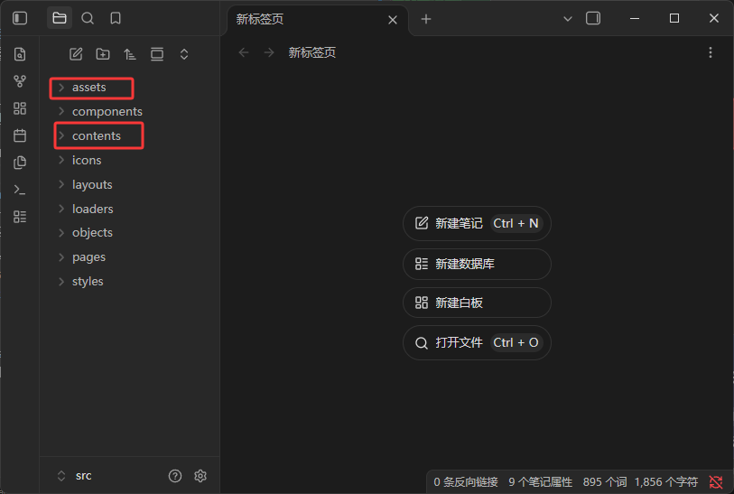
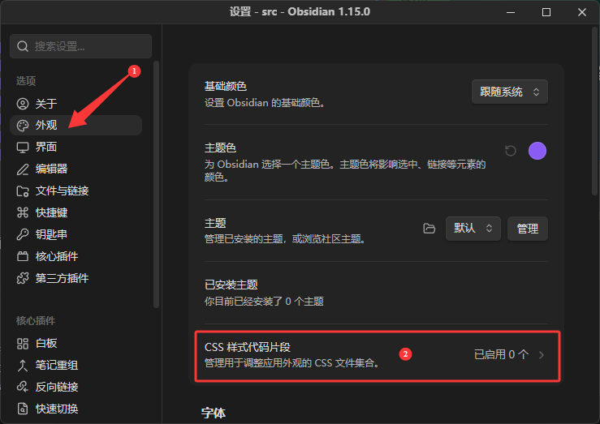
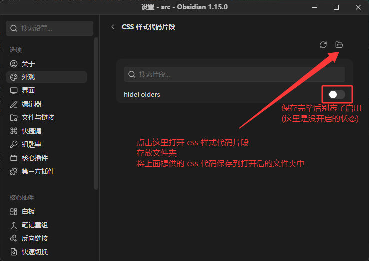
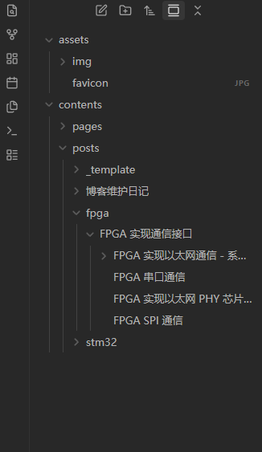

## 为什么用 Obsidian 写笔记

博客的文章都是一个个本地 Markdown 文件, 用 Obsidian 直接打开项目目录来写作, 可以省掉「在编辑器里写一遍, 再去浏览器里预览」的来回切换:

- 直接打开本地文件夹作为仓库, 不需要导入或转换;
- 原生支持 Markdown、代码块与相对路径图片, 和博客的写作格式一致;
- 可以用 CSS 片段调整界面, 把与写作无关的工程目录隐藏掉。

下面记录一下具体的配置过程。

## 准备工作

> 下文的 `[ROOT]` 指项目根目录 (即包含 `package.json` 的那一层)。

### 创建 Obsidian 仓库

在 Obsidian 中选择「打开本地仓库」, 然后选中项目的 `src` 目录即可:



打开之后, 左侧会列出 `src` 下的所有子目录:



### 隐藏与写作无关的目录

写作时其实只关心 `assets` 和 `contents` 两个目录 (图中红框圈出来的部分), 其余目录 (`components`、`layouts`、`objects` 等) 都可以隐藏。把下面这段 CSS 保存到 `.obsidian/snippets/` 目录下:

```css
.nav-folder:has([data-path="components"]),
.nav-folder:has([data-path="icons"]),
.nav-folder:has([data-path="layouts"]),
.nav-folder:has([data-path="loaders"]),
.nav-folder:has([data-path="objects"]),
.nav-folder:has([data-path="pages"]),
.nav-folder:has([data-path="styles"]) {
  display: none;
}
```

保存后, 到 `设置 -> 外观 -> CSS 代码片段` 里启用即可。找不到 `.obsidian/snippets` 目录时, 可以在同一设置页点右上角的「打开目录」:




启用后, 左侧的文件树会清爽很多:



### 把文章图片迁移到 assets 目录

之前文章的图片都放在 `[ROOT]/public` 下, 而 `public` 里的文件会被原样复制到站点根目录, 所以 Markdown 里应该按站点根路径引用:

```text
/img/posts/blog/05/xxx.png
```

如果写成带 `public` 前缀的 `/public/img/posts/blog/05/xxx.png`, Vite 会报警告, 提示去掉 `public` 前缀。

但站点根路径 (`/img/...`) 在 Obsidian 里是找不到的 —— Obsidian 按本地文件系统的相对路径解析图片, 预览时会直接断图。

把图片迁到 `[ROOT]/src/assets` 下就能同时满足两边: Markdown 用相对路径引用, Obsidian 能正常预览, 构建时 Vite 也会正常处理这些图片资源。

相对路径按文章所在目录的层级向上推:

```text
../../../(有多少层就向上推多少层)/assets/.../xxx.png
```

以这篇为例, 文章在 `src/contents/posts/博客维护日记/` 下, 向上三层到 `src/`, 图片在 `src/assets/img/posts/blog/05/` 下, 所以写成:

```text
../../../assets/img/posts/blog/05/obsidian-open-folder.png
```

这样图片在 Obsidian 里能正常显示, 构建出来的 HTML 页面也不受影响。

## 小结

- 用 Obsidian 打开项目的 `src` 目录, 直接复用现有的 Markdown 文件;
- 在 `.obsidian/snippets` 里放一段 CSS, 隐藏与写作无关的工程目录;
- 图片统一放在 `src/assets` 下, Markdown 用相对路径引用, Obsidian 预览和 Vite 构建都能正常工作。
