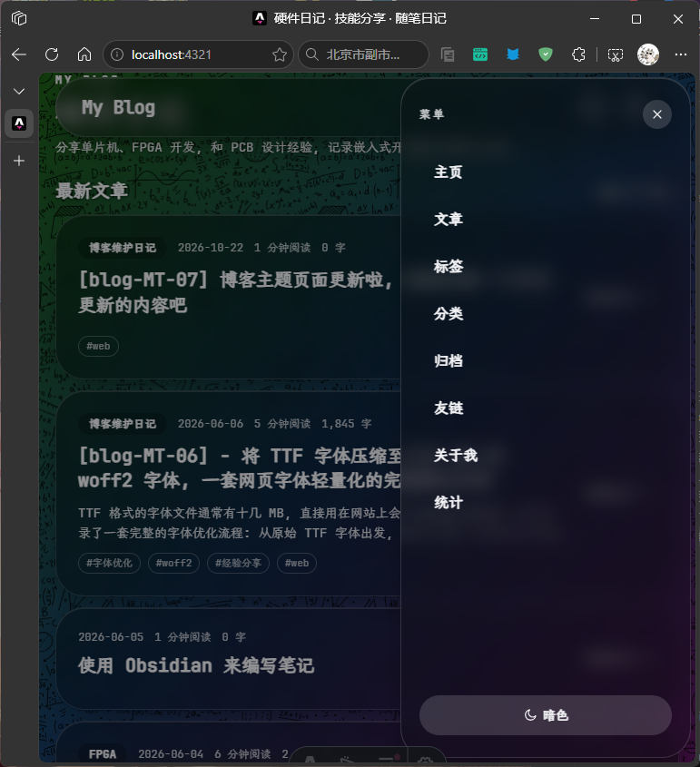
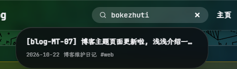
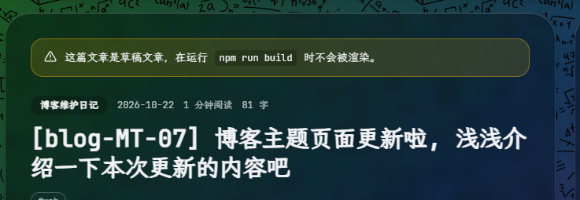

## 主要更新内容
- 最明显的变化莫过于主题了，主题由原来的 Fuwari 换成了毛玻璃质感，感觉这样很简约又有高级感。

- 窄屏下的顶部导航栏会变成汉堡菜单，点击后从右侧弹出。

- 文章搜索支持拼音输入

- 草稿文章在 `dev` 环境下预览时, 会在顶部生成一个提示

- 右侧的侧边栏增加了数据统计，评论数量、总访问量、访客数量 (为了防止对服务器造成压力，数据每 1 小时更新一次).

:::
note [fine]
大致的新增内容就是这么多了, `99.99%` 的内容都是使用 `deepseek v4 pro` 对话生成的产物, 也有一些是用的 `deepseek v4 flash`, 本人只对部分功能进行了细化和微调。

(OS: 不得不感慨一下现在的 AI 真的是非常非常的强大啊 |´・ω・)ノ)
:::

## 关于开源
这个主题目前仍然在修改和添加一些小功能中, 待到时机合适和完善时会考虑开源.
